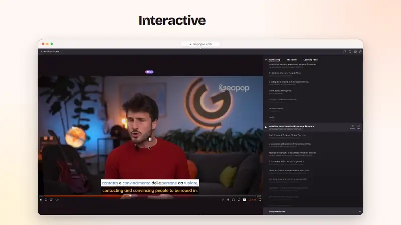
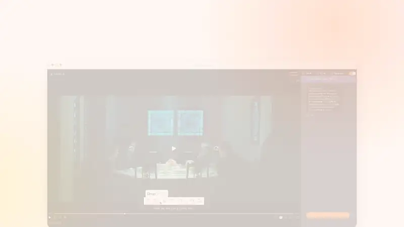
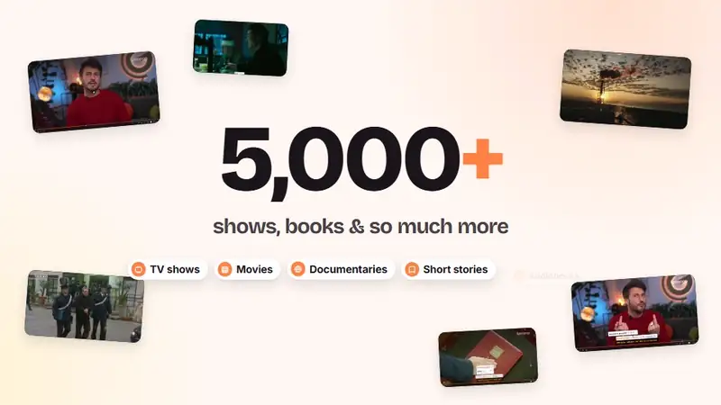
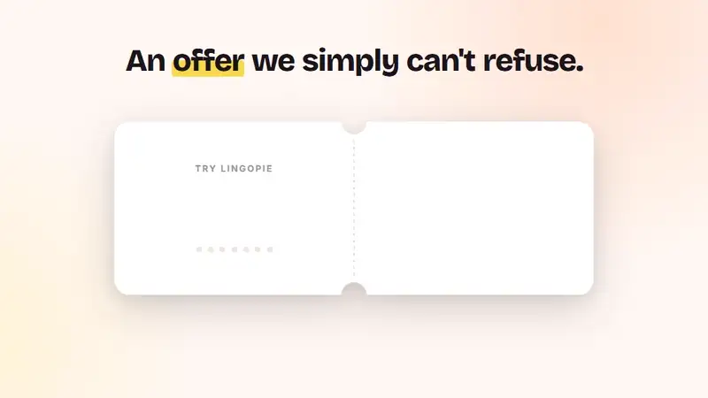

# Lingopie · Learn With What You Love: the promo

  
  
  
  

<h3 align="center"><a href="https://raisulsohan.github.io/Lingopie-promo-animation/">▶ Watch the whole promo (1:37) in your browser</a></h3>

Click a clip to open its scene.

  <strong>A client promo designed and animated in Adobe After Effects by <a href="https://raisulsohan.com">Raisul Sohan</a></strong>

The clips above are short silent previews of key moments. The full promo plays with sound.

---

A 97.5-second promo for **Lingopie**, the language-learning platform that teaches through real movies, TV shows and documentaries. The brief was to take the client's voice-over and raw product screen recordings and turn them into a clean, modern promo that shows how the product actually works and ends on the offer.

Delivered in two formats:

| Format | Resolution | Use |
| --- | --- | --- |
| 16:9 | 3840 × 2160 (4K) | YouTube, website, landing page |
| 4:5 | 2160 × 2700 | Instagram / Facebook feed |

Both are 30 fps, H.264 at a constant 70 Mbps with 320 kbps AAC audio, to meet the client's spec of 4K at no less than 50 Mbps.

## Watch

**Online: https://raisulsohan.github.io/Lingopie-promo-animation/**. Play the whole promo or jump to any scene, in 16:9 or 4:5.

- `index.html`: the promo with a 16:9 / 4:5 switch and a scene list.
- `preview/Lingopie_film_Desktop.html` (16:9) and `preview/Lingopie_film_Mobile.html` (4:5): the full promo on its own page.

Player controls: play/pause, restart, frame step, seek bar, time and frame counter, speed, loop, mute, volume and fullscreen.
Keys: <kbd>Space</kbd>/<kbd>K</kbd> play/pause, <kbd>←</kbd>/<kbd>→</kbd> one second, <kbd>,</kbd>/<kbd>.</kbd> one frame, <kbd>Home</kbd>/<kbd>End</kbd> start/end, <kbd>M</kbd> mute, <kbd>L</kbd> loop, <kbd>F</kbd> fullscreen.

---

## The story

The promo follows the voice-over word for word. Every headline, highlight and card hits its line on the spoken word.

| Scene | Name | Time |
|---|---|---|
| 01 | Hook: memorising word lists gets struck out. *Just watch what you love.* | 0:00–0:08 |
| 02 | Interactive subtitles: click any word to see what it means and hear how it's pronounced | 0:08–0:15 |
| 03 | Save → practice → flashcards → quiz | 0:15–0:22 |
| 04 | Daily routine: "Today's goal", streak, and the Netflix & Disney+ extension | 0:22–0:30 |
| 05 | *"The platform I've been using is…"* Lingopie | 0:30–0:41 |
| 06 | Immersion & nuance: Italian and Japanese scenes in real context | 0:41–0:59 |
| 07 | Library & languages: 5,000+ shows, books & more, 17 languages | 0:59–1:08 |
| 08 | *"Who said language learning had to be tedious?"* | 1:08–1:19 |
| 09 | Montage: *learn a language the most enjoyable way* | 1:19–1:23 |
| 10 | Offer & end card: a ticket tears in two, 7 days free and 73% off | 1:23–1:37 |

## Look & feel

- **Style:** clean, minimal, modern. A warm off-white background, soft gradients, a faint dot grid and floating app windows with gentle camera moves.
- **Brand colours:** Lingopie orange `#FF8243`, ink `#1A151A`, warm white `#FFF8F2`, with yellow and lime for highlights.
- **Type:** Bricolage Grotesque for headlines, Inter for UI and supporting text.
- **Motion:** words land on the voice-over and highlights follow their word. Cards and windows move with eased camera pushes rather than hard cuts.

## Workflow

- Motion design and animation in **Adobe After Effects**.
- Finishing and subtitles in **Premiere Pro**.
- Timing locked to the client's word-level SRT of the voice-over.
- Music, sound design and the voice-over mixed into one final stereo track.

## Author & Credits

- **Motion Designer & Animator:** [Raisul Sohan](https://raisulsohan.com) ([@raisulsohan](https://github.com/raisulsohan))
- **Client:** Lingopie
- Footage, voice-over and brand belong to Lingopie and appear here only to show the work.

---

*Client: Lingopie · Promo / VSL · 2026*
